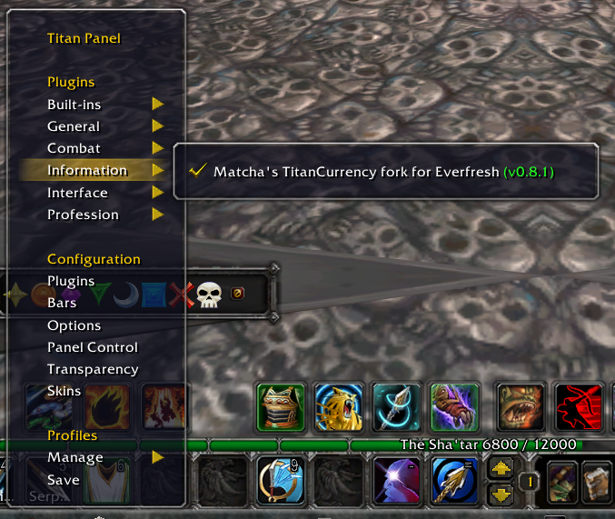
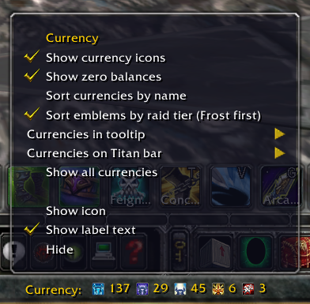

# Matcha's TitanCurrency fork

Improved currency display for **WoW WotLK 3.3.5** and **Titan Panel 4.3.8.30300**. Works on compatible servers beyond Everfresh. The gold tracking plugin is separate and optional.

## Downloads

- [Download TitanCurrency](downloads/Matchas-TitanCurrency-fork.zip?raw=1)
- [Download original Titan Panel WotLK ZIP](https://github.com/Cacato/Matchas-Everfresh-reset-gold-tracking-plugin-and-TitanCurrency-fork/blob/main/downloads/felbite.com-titanpanel-wotlk-titan-panel.zip?raw=1)
- [Titan Panel source page on Felbite](https://felbite.com/addon/4497-titanpanel/)
- [Optional Everfresh reset gold tracking plugin](https://github.com/Cacato/Matchas-Everfresh-reset-gold-tracking-plugin-for-Titanpanel)

## Install

1. Close WoW and back up your existing `TitanCurrency` folder.
2. Install Titan Panel first if needed.
3. Extract the TitanCurrency ZIP into `Interface/AddOns`. Keep the `TitanCurrency` folder name.
4. Start WoW, enable the addon, then enable Currency under **Titan Panel → Plugins → Information**.
5. Right-click its bar button for options.

## Features

- Currency icons in the tooltip and directly on Titan Panel.
- Independent selections for the tooltip and bar.
- Icon, zero balance, alphabetical sorting, and raid-tier sorting checkboxes.
- Default emblem order: **Frost → Triumph → Conquest → Valor → Heroism**.
- **Show all currencies** is a toggle; switching it off restores your manual selections.
- Drag a balance onto another to reorder the bar. The currency icon follows your cursor.
- Settings and manual order save **per character**.
- Separate label anchoring and single-line vertical centering.

## Screenshots

### Enable the plugin

Find Currency under **Plugins → Information**.

### Options and bar display

## Credits

Original Titan Currency by **Greenhorns @ Vek'Nilash**. Fork maintained by **Matcha**. Titan Panel is credited to its authors; Felbite hosts the supplied WotLK distribution.

Lua 5.1 checks cover options/menu binding, per-character selections, ordering, drag feedback, show-all restoration, and layout anchors. In-game behavior was reviewed during development.
